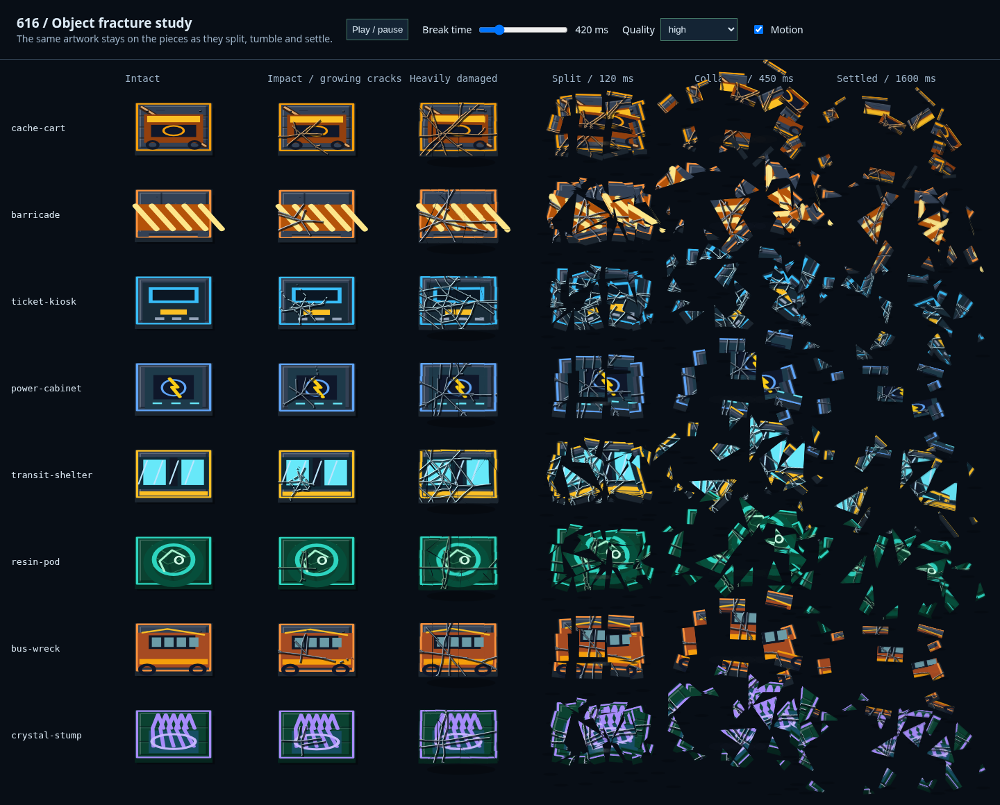

# Scenery destruction and mobile overlay previews

The source for the interactive destruction preview is [scenery-fracture.html](../../../artifacts/survivor-616/previews/scenery-fracture.html). Start the game dev server (`pnpm dev` from the repo root), then open `http://localhost:3000/previews/scenery-fracture.html`. Play/pause, scrub break time, select graphics quality or turn motion off. It uses the real map-prop renderer, not a mock drawing.

Each row compares intact, growing impact fractures, critical damage, initial separation, collapse and settled fragments. The timeline slider controls the collapse column. Wood separates into board sections, metal into panels, and brittle surfaces use the existing ice/glass triangular tiling. All fragments keep their original painted detail.

Mobile evidence is saved alongside this file for Classic and New GUI layouts: dock placement, chat, and in-run settings. The tests use a 390 × 664 viewport, animated themes, reduced UI opacity, and world mirror/invert settings. They check hit targets with `elementFromPoint`, open and close the dialog/search layers, type in run settings, switch GUI layout inside the paused settings panel, defer unlock toasts behind dialogs, return/resume/reopen pause, and verify held-key repeats do not toggle the menu twice.

To regenerate the material screenshot, run `node scripts/capture-scenery-preview.mjs` from `artifacts/survivor-616` with the dev server at port 3000. To regenerate the phone screenshots, run `E2E_PORT=3000 pnpm exec playwright test e2e/overlay-layering.spec.ts` from the same folder. Run only one Playwright process per output directory.

These are Chromium screenshots. Physical iPhone memory and touch behavior still need a device check.

0.42.60 adds Tab/Shift+Tab containment and dock-focus restoration checks for chat, plus Escape from settings and soundtrack inputs. The material preview now keeps floor shadows out of the moving artwork and carries the fracture detail on each piece. The bounded-cache regression is documented in `src/game/render/propTextureCache.test.ts` under the game package.
